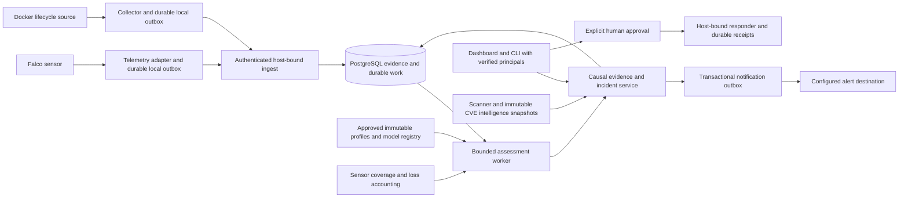
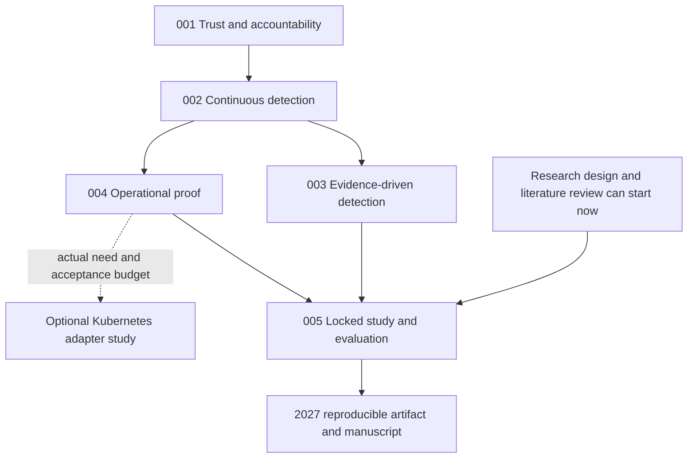

# Porygon pathway: reliable runtime detection and a reproducible 2027 study

Prepared 2026-10-26 against commit `b04aaea` **and the uncommitted working tree**. The improve skill was used for a read-only source audit and planning. Only files under `plans/` were created by this planning pass. Concurrent implementation work is not frozen or approved by this plan.

## The destination

Build a Docker-first, self-hosted runtime security tool that a technically capable person can install, leave running, understand and recover. Its defining capability should be **deployment-scoped behavioral detection with traceable causal evidence and explicit telemetry uncertainty**. That is a concrete product direction grounded in the existing digest profiles, process lineage, incident evidence and durable queues. It is a proposed research direction, not a claim of novelty or superiority.

The first user can be you. A small Linux lab with realistic service workloads, repeatable changes and failure drills is enough to begin. There is no assumed company partner, enterprise budget or requirement to operate a Kubernetes cluster. Company usability will be demonstrated through operational evidence, not through a feature checklist.

### What a strong result looks like

1. A fresh installation begins collecting and reports exactly which telemetry it can observe.
2. An operator can enroll a workload, approve a benign profile, observe candidates in shadow mode and roll back a profile.
3. Scheduled assessments create incidents unattended; retries and service restarts preserve logical results.
4. An incident explains what happened with actual event IDs, authenticated host/container scope, observed versus inferred links and coverage state.
5. Legitimate maintenance/debugging does not routinely create high-severity incidents; performance is measured under declared workloads.
6. An operator can receive a reliable alert, review evidence and approve an exact target action, then recover from interrupted execution.
7. The same data and immutable configuration can regenerate the paper's tables offline. Unsupported results are reported honestly.

## Recommended architecture

Retain Python, FastAPI, PostgreSQL, Falco, the existing sensor adapters and the vanilla dashboard. Separate responsibilities inside the codebase before adding infrastructure. A worker can run as a separate process using the same backend package; a new package/service is justified only by a real privilege, deployment or scaling boundary.

The sensor side retains minimal privileges. The control plane never needs a host Docker socket. Ingest acknowledges after durable acceptance. The worker controls event-time windows, lateness and replay. Profile training is a separate approved operation; detection does not automatically learn from whatever it observes. Missing telemetry is a visible outcome, not evidence of benign activity. Vulnerability context helps prioritize incidents but does not prove exploitability or compromise.

Keep relational evidence tables and bounded causal traversals first. A graph database, GNN, custom eBPF engine and distributed broker are all additional costs that must earn their place through a measured limitation.

## Vetted findings, ordered by value relative to work and risk

Impact is specific to this codebase. Effort: S = hours, M = several days, L = multiple weeks including integration; plan estimates include more work than an isolated fix. Confidence is high where the execution path is directly visible. Architectural proposals appear in the separate section below.

| ID | Finding | Category | Impact | Effort | Fix risk | Confidence | Verified evidence | Plan |
|---|---|---|---|---|---|---|---|---|
| TRUST-01 | Services import the entire `.env`, distributing operator/database credentials beyond the services that require them. | Security | High: service/operator separation is weakened even before remote deployment. | M | Medium: removing implicit settings can break consumers. | High | `compose.yaml:139`, `213`, `273`, `328`; explicit backend credentials at `45–53`. | 001 |
| SCI-01 | The default classifier builds hand-authored trees; fixed-temperature confidence sharpening and tree-path deltas do not establish a trained, calibrated Random Forest with exact TreeSHAP output explanations. | Correctness / Docs | High: current product and paper claims can exceed implementation evidence. | S to label accurately; L to train/validate | Low for factual labels; high for model replacement | High | `backend/src/porygon_api/ml_classifier.py:365–373`, `508`, `519–531`, `552–555`; `README.md:40–49`. | 003 |
| SCI-02 | Study analysis assigns split labels, then selects all-but-last runs chronologically as fit data without consulting those labels. | Correctness / Tests | High: recorded split assignment does not guarantee actual analysis isolation; current outputs remain pilot-only. | M | Medium: stricter fitting can reveal insufficient data. | High | `experiments/study.py:254–259` versus `323–342`. | 005 |
| AUDIT-01 | Individual status changes trust `payload.actor`; bulk closure bypasses the locked, evidence-appending transition path. | Correctness / Security | High: operator accountability and bulk closure audit semantics are inconsistent. | M | Medium: lifecycle callers must migrate together. | High | `backend/src/porygon_api/main.py:2585–2618`, `2643–2667`; auth only returns `None` in `security.py:18–23`. | 001 |
| DET-01 | ML sequence features use adjacent input records rather than verified parent/lifetime links; image-only queries can collect descending recent events across containers. | Correctness / Architecture | High: unrelated executions can imply sequence patterns and intended observation scope is unclear. | M | Medium: a new explicit feature contract is needed. | High | `backend/src/porygon_api/ml_classifier.py:172–217`; `backend/src/porygon_api/main.py:2882–2888`. | 003 |
| REL-01 | Email notifications send before recording local notification state; a bounded latest-incident query is not a durable event consumer. | Correctness / DX | Medium-high: duplicate notification after crash, and older incidents can be missed under backlog. | M | Medium: external delivery is inherently at-least-once. | High | `scripts/incident_alerts.py:107–120`, `199–218`. | 004 |
| OBS-01 | Adapter readiness checks file/thread/heartbeat state, while its counters do not report kernel drop coverage. | Tests / Operations | High: a healthy-looking downstream path cannot establish complete kernel capture. | M | Medium: version-specific metrics need validation. | High for the current readiness/counter scope; coverage integration is future work | `telemetry/src/porygon_telemetry/main.py:213–237`; `state.py:22–32`; high-volume capture configuration `compose.yaml:393–395`. | 004 |
| REP-01 | Docker builds install from manifests without a checked-in resolved Python dependency graph. | Dependencies / Tooling | Medium: transitive resolution can differ between builds, weakening reproducibility. | M | Medium: constraints must be kept current. | High | `backend/Dockerfile:12–19`, `backend/pyproject.toml:15–25`; equivalent service packaging. No Python lockfile found in scoped inventory. | 004 |

No live credential value was opened or reproduced. The loopback gateway/private-network design is intentional: anonymous local reads are a **remote deployment gate**, not presented here as an internet-exposed exploit. No advisory database scan was run, so this audit makes no current dependency-CVE claim.

## Direction decisions

### 1. Make detection an unattended service

The lifespan starts retention and identity repair (`backend/src/porygon_api/main.py:202–221`); score/detection computation is request-driven (`1670–1684`, `2313–2325`). Add a durable assessment lifecycle and controlled profile enrollment. This is the largest product improvement because it turns a set of tools into a security system that can keep operating when nobody is watching the dashboard.

### 2. Make evidence quality the differentiator

Kernel evidence now exists separately (`models.py:190–244`), while the current detection path queries process and lifecycle tables (`main.py:2382–2403`). Joining the streams requires real process identity, field availability and temporal semantics; merely adding more rules would overstate causality. Keep the existing exec detector as a comparator and introduce a separate, evaluable causal contract.

### 3. Prove a small deployment before designing a fleet

Existing FULL-durability spools, response receipts and protected-container controls are valuable starting points. Add alert delivery, restore drills, coverage accounting and a three-node lab envelope. Postpone a streaming broker until repeatable measurements identify a bottleneck it would actually solve.

### 4. Publish one defensible systems result

The frozen study asks a specific profile-scope question (`docs/research/research-protocol.md:19–31`). Its confirmatory runner is still intentionally absent (`experiments/run.py:463–487`). Finish that path accurately or prospectively specify a separate extension; do not broaden the frozen study after seeing results. The proposed 2027 extension tests causal evidence and explicit uncertainty under workload change, with strong negative controls.

## Execution order and status

The user explicitly requested a pathway plan, so this package covers that selected direction as five bounded workstreams rather than asking them to select individual audit rows. Start one implementation workstream at a time; each plan is self-contained and includes current source excerpts, scope, tests and stop conditions.

| Plan | Deliverable | Priority | Effort estimate | Dependencies | Status |
|---|---|---|---|---|---|
| [001](001-trust-and-accountability.md) | Least-privilege credentials, verified principals, consistent incident transitions | P1 local boundaries; remote identity integration conditional | 2–3 focused weeks | None | IN PROGRESS — self-hosted identities/host scopes APPROVED; conditional remote HTTPS/OIDC deferred |
| [002](002-continuous-detection.md) | Durable window assessment, approved profile lifecycle, unattended incidents | P1 | 3–5 focused weeks | 001 | DONE — authenticated unattended canary and recovery accepted |
| [003](003-evidence-driven-detection.md) | Truthful model contract, causal multisignal rules, optional trained/calibrated model | P1 | 5–8 focused weeks | 001; 002 for unattended validation | IN PROGRESS — metadata correction APPROVED; causal/training work pending |
| [004](004-operational-proof.md) | Coverage, notification outbox, restore/upgrade/capacity tests, reproducible releases | P1; full fleet extensions deferred | 4–6 focused weeks | 001–002; repeat final soak after 003 | TODO |
| [005](005-journal-evaluation.md) | Correct split consumption, actual confirmatory runner and prospective journal study | P1 | 6–10 focused weeks plus collection/review | Design now; freeze after 002–004 | TODO |

Statuses: TODO, IN PROGRESS, DONE, BLOCKED (reason), REJECTED (reason), STALE (reconcile evidence). A plan is DONE only after its machine-checkable acceptance gates pass. These coarse estimates assume sustained work by one capable contributor; learning, hardware constraints and part-time availability can extend them. They are not delivery promises.

### First implementation slice

Take plan 001 step 1 (credential allowlists), plan 001 incident-transition correctness, and plan 003 step 1 (accurate heuristic/model metadata) as the first reviewable fixes. Do not start a broad auth rewrite and detector redesign simultaneously. Once those foundations pass, implement plan 002's unattended canary before adding more detection classes.

Remote OIDC, SAML integrations, tenancy, billing and enterprise provisioning are not prerequisites for a strong local project. Plan 001's `Principal`/permission contracts can initially use explicit local identities and scoped service credentials. Add the deployment profile/OIDC adapter when remote multi-user operation is actually selected; it must still be tested before that mode ships.

## Calendar toward 2027

Use acceptance gates to determine progress; the months below are a planning sketch beginning in late October 2026.

| Window | Main objective | Exit evidence |
|---|---|---|
| November–December 2026 | Correct trust/claims, establish unattended assessments and profile lifecycle | Permission matrix, regression tests, automatic canary incident without manual compute/detect calls |
| January–March 2027 | Causal runtime evidence, realistic benign controls, evaluated optional model, delivery/recovery | Held-out engineering comparisons, evidence replay, restore drill and measured load envelope |
| April–June 2027 | Freeze prospective study, run independent pilot, lock sample size, collect held-out evaluation | Pre-collection protocol/analysis hashes, complete failed/excluded trial accounting, reproducible tables |
| After those gates pass in 2027 | Independent reproduction where feasible; prepare and submit the manuscript | Claim-to-result map, offline artifact replay, documented limitations and negative results |

Do not wait until the paper-writing month to discover that the confirmatory runner does not execute. Build that runner and validate its gates early using software fixtures; real confirmatory collection begins only after implementation and study design are frozen.

## Kubernetes decision gate

Kubernetes is optional. Add it only if there is a concrete target workload, deployment requirement or research question that Docker cannot answer, and there is enough time/hardware to maintain a cluster acceptance suite. A Helm chart alone does not make a Docker tool Kubernetes-compatible.

Before authorizing implementation, complete a bounded adapter design study with these required outputs:

- A runtime identity adapter mapping cluster UID, node UID, pod UID, container ID, namespace and controller owner; image identity alone is insufficient.
- Actual containerd/CRI-O lifecycle observation and reconciliation, not a Docker-socket mount relabelled as a DaemonSet.
- Certificate/credential enrollment and revocation, host binding, and offline spooling for agents; no operator credential on nodes.
- Namespace/owner protection, service-account permissions and an observe-only default. Response actions remain independently authorized and rate-limited.
- A **tested** containment mechanism. Kubernetes NetworkPolicies are additive, so adding a deny-all policy does not override an existing allow policy. Existing-connection behavior can also depend on the implementation. A supported CNI-specific deny/isolation mechanism or explicit managed-policy ownership contract is required before calling it quarantine. Verify real ingress/egress and rollback against an existing allow-all policy; do not infer isolation from object creation. See the [official NetworkPolicy semantics](https://kubernetes.io/docs/concepts/services-networking/network-policies/).
- An isolated cluster suite for rescheduling, pod replacement, node restart, host-network workloads, namespace boundaries, overlapping policies and credential revocation. Start with one runtime/CNI combination and name unsupported combinations.

If this gate is not justified, complete the Docker-first project and paper without Kubernetes. The unresolved Kubernetes feature is not a defect in the declared Docker deployment.

## Decisions considered and rejected or deferred

- **Repeat the earlier cache, local-image, rare-shell or multi-syscall backlog:** rejected as stale. Current source includes collector TTL/host cache, explicit local image identities, command-lineage/rare-execution contracts and an actively integrated kernel channel. Revalidate them; do not schedule them as missing features.
- **Treat kernel storage isolation from legacy exec profiles as a bug:** rejected; it preserves existing contracts. New detectors need explicit contract dispatch.
- **Treat the absent confirmatory runner as an authorization bypass:** rejected; it currently refuses safely. Implementing the runner is a planned research capability gap.
- **Assume every shell, root process, `/tmp` binary, memfd or CVE is malicious:** rejected; those are context-dependent observations requiring negative controls and supporting evidence.
- **Claim the current hand-authored ensemble is a trained random forest:** rejected by source evidence. Retain it honestly as a comparator.
- **Replace Falco with a custom kernel module/probe immediately:** deferred; capture coverage and resource measurements must first show a need.
- **Add Kafka/NATS, ClickHouse or a graph database immediately:** deferred until a measured bottleneck and operational owner exist.
- **Use online learning to automatically absorb all new behavior:** rejected as default; it can normalize attacker behavior and erases an auditable baseline decision.
- **Let the AI auditor decide containment:** rejected; advisory summaries must not become independent authorization.
- **Rewrite the dashboard into a new frontend framework:** deferred; it does not address the verified detector and operational gaps.
- **Change frozen research files to match current implementation:** rejected. Add a prospective study and explicit dispatch instead.
- **Promise journal acceptance or superiority:** rejected; the study must be capable of reporting an unfavorable result.

## Evidence, drift and audit scope

`evidence-index.json` records hashes of the source excerpts used in the plans. Run `python3 plans/check_plan_evidence.py --plan all` before execution. The checker reports drift; it never edits files. Hash changes after legitimate earlier work require re-reading and revising later plans, not bypassing the check. Existing dirty files are owned by their current authors; do not reset them.

This audit covered the core API/auth/incident paths, model feature/default prediction implementation, sensor delivery/readiness shape, Compose trust boundaries, detection orchestration, experiment split/confirmatory code, verification tooling and stated architecture/research intent. Direct source reads confirmed the findings. Parallel read-only audits were attempted, but those agents stopped at a usage limit; their unfinished work is not claimed as independent review.

Not audited exhaustively: every frontend rendering sink, every SQL query plan, every pinned dependency advisory, container image contents, host kernel configuration, live cluster/CNI enforcement, the full empirical dataset or novelty against a systematic 2026 literature search. The literature and capacity claims remain explicit work in plans 004–005. No current throughput, production-readiness or model-accuracy figure is invented.

Planning validation completed: repository-wide critical Ruff checks and `scripts/check_research_protocol.py` passed. Full service/live acceptance is specified for implementation, not rerun during this read-only planning pass. Service rebuilds, data collection and source implementation are outside the improve skill's planning mode.

External design checks used primary documentation: [Falco metrics](https://falco.org/docs/concepts/metrics/), [Falco syscall drops](https://falco.org/docs/troubleshooting/dropping/), [Kubernetes NetworkPolicies](https://kubernetes.io/docs/concepts/services-networking/network-policies/) and [OpenTelemetry queue/retry resiliency](https://opentelemetry.io/docs/collector/resiliency/). They support design boundaries; they are not evidence that Porygon already implements those capabilities.

## Current execution

The isolated execution remains in `/home/anuruprkris/.codex/worktrees/service-trust/final_yeat_work`. Self-hosted enrolled identities and plan 002 continuous detection are approved. Plan 003 metadata correction was approved earlier; causal detection/training, operational proof and journal collection remain open. Remote HTTPS/OIDC remains conditional. No commit, merge or push is authorized.

## Latest reviewed execution

The local-foundation and metadata slices are APPROVED in `/home/anuruprkris/.codex/worktrees/service-trust/final_yeat_work/plans/local-foundation-review.md`. Verification: 424 active-service tests passed, 245 host tests passed (2 skipped), live acceptance completed, response mode disabled. The full five-plan pathway remains in progress. No commit, merge or push was made.

## Current larger implementation batch

Per the user's testing preference, implementation is grouped into coherent changes and the full rebuild/unit/live battery is reserved for the completed increment. Static review and narrow checks may resolve a specific blocker; previously passing suites are not rerun after every small edit. The next batch implements persisted credentials, enforced route permissions, assigned host/worker boundaries and immutable response-target hosts, followed by continuous detection using the reviewed identity contract. Remote OIDC remains conditional; no company integration or journal collection is assumed.

## Identity batch source review and next execution

The enrolled-identity batch is source-reviewed, with final acceptance pending. Its focused checks reported 47 backend passes (2 PostgreSQL-only checks deferred), 15 responder passes and 10 CLI/Compose passes. This is distinct from the earlier fully accepted local-foundation battery. The next executor increment implements plan 002 in the same isolated worktree; no primary source changes or publication are authorized. Plan 002 records the expected orchestration drift and explicit host/container, atomicity, immutable configuration and unknown-coverage requirements. Full rebuilt active-container, PostgreSQL and live acceptance is reserved for the combined source freeze.

## Combined acceptance — 2026-10-27

[Identity and continuous detection review](identity-and-continuous-review.md) records the approved increment. All 476 service test cases were covered successfully across the full batch and one targeted compatibility recheck; 254 host tests passed (2 skipped). Static, protocol, infrastructure and the complete nested live detection/containment chain passed. The enrolled-mode canary created an incident unattended, recovered from worker outage, and passed late revision/replay and uncertainty checks. Temporary credentials were revoked and their secret files removed. All eight isolated services are healthy; local mode and disabled response/API scheduling are restored. All 279 tracked primary-checkout files still match the isolation baseline. No commit, push, merge or mirror was performed.

Next source work is plan 003 causal evidence and the operational components in plan 004; re-read their drifted evidence before execution. Empirical model training and journal data collection remain separate acceptance gates.

## Remaining engineering batch — 2026-10-27

The user requested that all remaining implementation be completed before any new testing. One executor now owns the combined003–005 source batch: additive causal evidence and optional validated model pipeline; operational coverage, notification durability, restore/capacity/release tooling; split-safe and protocol-faithful confirmatory/prospective evaluation tooling. The advisor and independent reviewer perform source review only. No pytest/checker/lint/build/live/benchmark execution is allowed until that complete source freeze. Physical study collection, real held-out model promotion, the three-node load envelope and seven-day soak remain measured gates, not generated results.

### Resumed source review

The resumed checkout is at `6f845d5`; the advisor did not create that commit. The previous executor is no longer active. A replacement sole executor continues in the same isolated checkout, preserving its existing source. No validation command has been run in this resumed batch.

Source review confirmed remaining host identity collisions in heartbeat/sample keys, missing output-drop/reset coverage, an unused comparator-report digest in model activation, and an unbounded DNS stage in webhook delivery. These are implementation corrections within plans 003–004. Plan 005 still requires the split-safe analysis, actual gated confirmatory runner, offline replay and immutable publication work; its old unconditional refusal is not completion. All remaining source and test definitions must be finished before the combined verification window opens.
